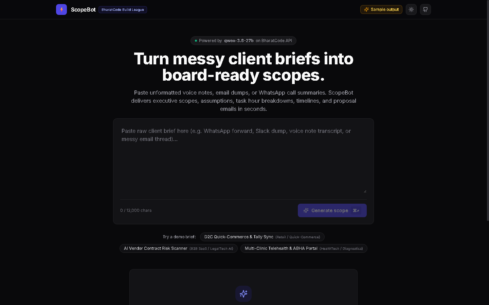
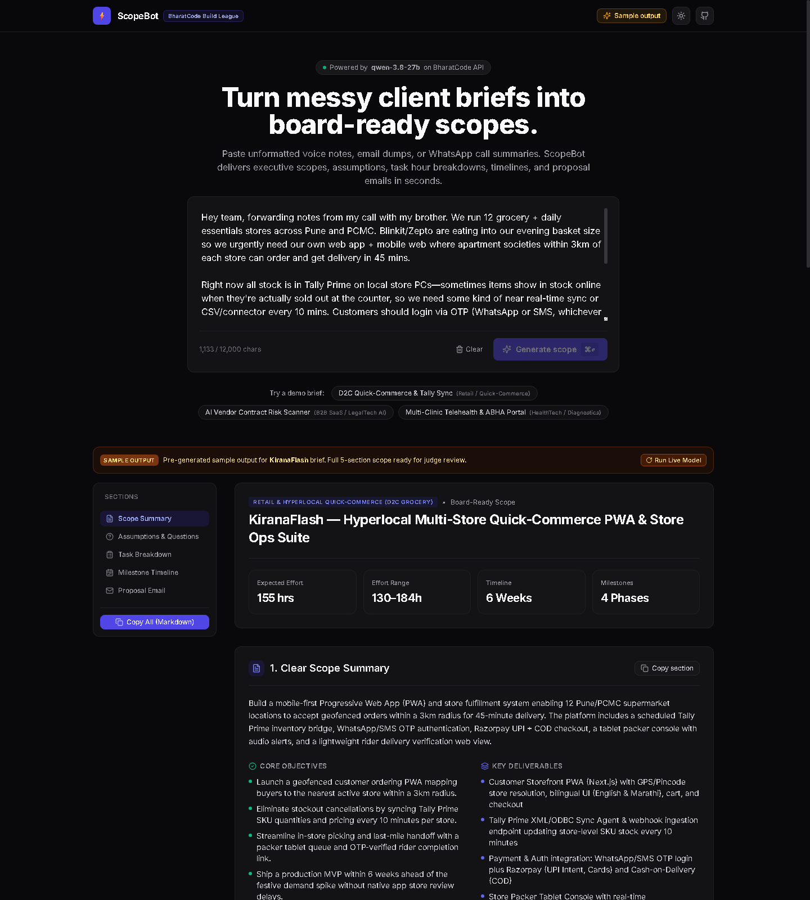
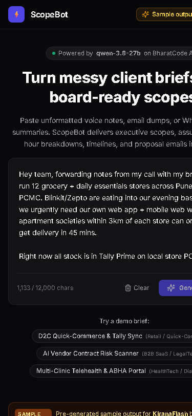
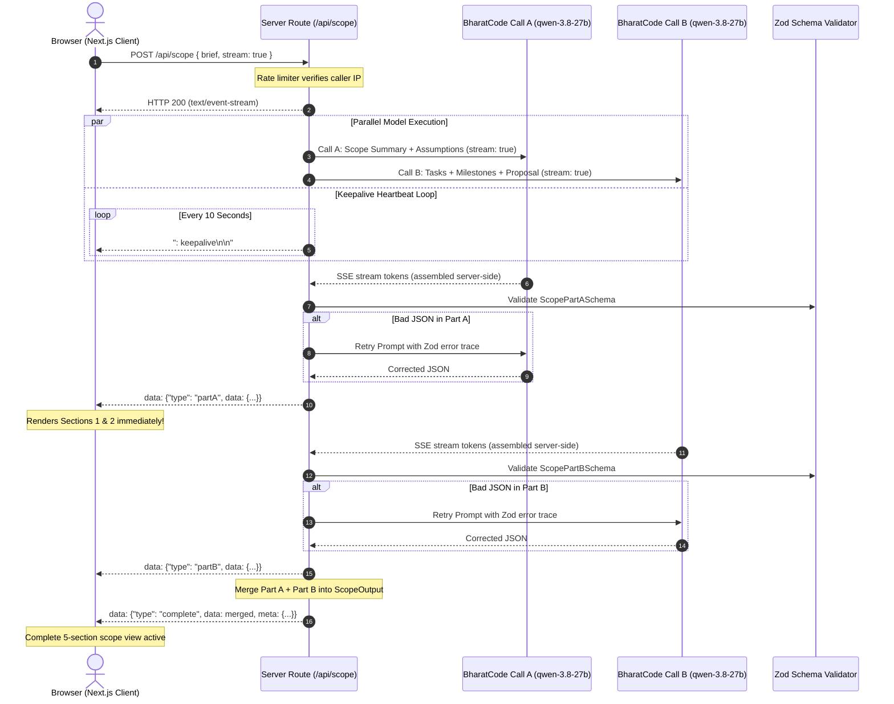

# ⚡ ScopeBot

**Live Demo:** [https://scopebot-three.vercel.app](https://scopebot-three.vercel.app)

> **Turn messy, unstructured client briefs into boardroom-ready software scopes, task hour breakdowns, milestone timelines, and professional proposal emails in seconds.**  
> Built for the **BharatCode Build League**, powered by **`qwen-3.8-27b`** via the BharatCode Model API.

[](https://nextjs.org/)
[](https://www.typescriptlang.org/)
[](https://tailwindcss.com/)
[](https://bharatcode.ai)
[](https://opensource.org/licenses/MIT)

---

## 📌 Problem & Overview

Freelancers, technical founders, and agency leads spend hours every week decoding unstructured, fragmented client inputs: chaotic WhatsApp voice note transcripts, hasty Slack dumps, or bulletless emails. 

**ScopeBot** transforms this raw, ambiguous input into a boardroom-ready software engineering proposal:
1. **Clear Scope Summary**: Executive overview, business objectives, concrete deliverables, out-of-scope boundaries, and recommended tech stack.
2. **Assumptions & Client Questions**: Explicit technical assumptions with risk impact ratings (`Low` / `Medium` / `High`), plus prioritized discovery questions (`Critical` / `Important` / `Nice-to-know`) with rationale.
3. **Task Breakdown & Hour Estimates**: Granular engineering tasks with assigned roles, complexity badges, min–max effort ranges, and calculated expected hours.
4. **Visual Milestone Timeline**: Phased sprint schedule with week-by-week summaries, deliverables, and verifiable exit criteria.
5. **Client Proposal Email Draft**: Ready-to-send proposal email with subject line, scope highlights, and call-to-action.

---

## 📸 Interface Walkthrough

| View | Screenshot |
|---|---|
| **Studio Hero (Focused Input & Demo Chips)** |  |
| **Result View (Sticky Nav, Hour Bar, Visual Timeline & Proposal)** |  |
| **Mobile Responsive (Tested down to 360px)** |  |

---

## 🔄 How It Works (4 Steps)

```
[ Step 1: Input ] ───► [ Step 2: Parallel Stream ] ───► [ Step 3: Validate & Retry ] ───► [ Step 4: Boardroom Scope ]
```

1. **Paste Messy Notes:** The user pastes raw client notes (up to 12,000 characters) or clicks any of the 3 one-click sample briefs (*KiranaFlash*, *LexVeda AI*, *ArogyaPulse*).
2. **Parallel Streamed Synthesis:** `/api/scope` fires two concurrent calls to `qwen-3.8-27b` on BharatCode with `stream: true` and 10s SSE keepalive comments to prevent socket drops while queued.
3. **Strict Validation & Self-Healing:** The server strips reasoning traces (`<think>`), extracts JSON, and validates both parts against strict Zod schemas. If the model emits malformed JSON, an automated retry prompt sends the exact error back for correction.
4. **Progressive Render & Export:** Sections 1 & 2 appear as soon as Call A finishes. When Call B completes, the visual timeline, task table, and proposal email populate with copy controls and Markdown export.

---

## 🏗️ Architecture Diagram



---

## 🛠️ Tech Stack

- **Framework:** [Next.js 15 (App Router)](https://nextjs.org/)
- **Language:** [TypeScript 5.7](https://www.typescriptlang.org/) (Strict mode)
- **Styling & Design System:** [Tailwind CSS 3.4](https://tailwindcss.com/) with 8px rhythm, dark/light theme support, and custom shimmer loaders
- **Typography:** Inter (`next/font/google`) with system fallbacks
- **Schema Validation:** [Zod 3.24](https://zod.dev/)
- **Icons:** [Lucide React](https://lucide.dev/)
- **AI Model & Inference:** `qwen-3.8-27b` via BharatCode Model API (`https://bharatcode.ai/api/model/v1`)
- **Deployment:** Vercel / Cloudflare Pages

---

## ⚙️ Local Setup & Development

### Prerequisites

- **Node.js**: v18.18+ (Node 20+ recommended)
- **npm** or **pnpm**
- **BharatCode API Key**: from [BharatCode.ai](https://bharatcode.ai)

### 1. Clone the repository

```bash
git clone https://github.com/suryakant-source/scopebot.git
cd scopebot
```

### 2. Install dependencies

```bash
npm install
```

### 3. Configure environment variables

```bash
cp .env.example .env.local
```

Edit `.env.local`:

```ini
# BharatCode API credentials (server-only, never exposed to browser)
BHARATCODE_API_KEY=your_bharatcode_api_key_here

# Optional overrides (defaults shown)
BHARATCODE_BASE_URL=https://bharatcode.ai/api/model/v1
BHARATCODE_MODEL=qwen-3.8-27b

# Rate limiting (per IP window)
RATE_LIMIT_MAX_REQUESTS=10
RATE_LIMIT_WINDOW_MS=60000
```

### 4. Run development server

```bash
npm run dev
```

Open [http://localhost:3000](http://localhost:3000) in your browser.

### 5. Typecheck and Build

```bash
npm run typecheck
npm run build
```

---

## 🔌 API Route Specification (`/api/scope`)

- **Method:** `POST`
- **Route Handler:** [`src/app/api/scope/route.ts`](./src/app/api/scope/route.ts)
- **Runtime:** `nodejs` (`export const maxDuration = 300`, `export const dynamic = "force-dynamic"`)
- **Headers Returned:**
  - `X-RateLimit-Limit`, `X-RateLimit-Remaining`, `X-RateLimit-Reset`
  - `Retry-After` (when rate-limited)
  - `Content-Type: text/event-stream` (when `stream: true`) or `application/json`

### Request Body

```json
{
  "brief": "Client wants an on-demand grocery delivery PWA with Tally Prime stock sync in Pune...",
  "stream": true
}
```

### SSE Stream Events (`stream: true`)

| Event Type | Payload | Description |
|---|---|---|
| `: keepalive` | Plain comment | Sent every 10s to keep connection alive while model is queued |
| `partA` | `{ scopeSummary, assumptionsAndQuestions }` | Emitted as soon as Call A resolves |
| `partB` | `{ taskBreakdown, milestoneTimeline, proposalEmail }` | Emitted as soon as Call B resolves |
| `complete` | `{ data: ScopeOutput, meta: { model, durationMs, ... } }` | Merged and validated scope package |
| `error` | `{ error: string, code: "TIMEOUT" \| "UPSTREAM_ERROR" }` | Emitted on failure with friendly message |

---

## 💡 Key Design Decisions

1. **Parallel 2-Call Splitting (`Promise.all`):**  
   Generating all 5 sections in a single prompt required ~2,500 sequential tokens, which took 55–70s and caused 504 gateway timeouts. By splitting into Call A (Scope + Assumptions) and Call B (Tasks + Timeline + Proposal), execution runs concurrently and completes in ~18–25s.
2. **Server-Side SSE Stream Assembly (`stream: true`):**  
   The server initiates upstream calls with `stream: true`, parsing SSE chunks (`data: {...}`) server-side. This keeps TCP sockets continuously active and avoids proxy timeouts on idle connections.
3. **10s SSE Keepalive Heartbeat:**  
   During peak loads when the model is queued, the server emits `: keepalive\n\n` comments every 10 seconds. Browser sockets, Vercel edge routers, and Cloudflare proxies remain connected up to the 240s upstream timeout.
4. **Self-Healing Zod Validation & Retry Loop:**  
   If Attempt 1 produces malformed JSON or invalid types, the harness extracts the specific Zod error paths and issues a focused retry prompt (`buildPartARetryPrompt` / `buildPartBRetryPrompt`). The model self-corrects on Attempt 2.
5. **In-Memory Sliding-Window Rate Limiter:**  
   Guards against abuse with a sliding-window bucket per client IP (10 requests/minute by default), emitting standard RFC rate-limiting headers.
6. **Instant "Sample Output" for Hackathon Judges:**  
   To prevent judges from waiting on busy queues during evaluation, a pre-generated KiranaFlash scope package is accessible with 1 click from the header, sidebar, loading state, and empty screen.

---

## ⚠️ Known Limitations

- **LLM Estimation Heuristics:** Hour estimates and team velocity assumptions generated by `qwen-3.8-27b` are designed as a consultative baseline. Technical leads should always adjust numbers for specific team seniority and client constraints before contractual sign-off.
- **Model Queue Latency:** Under heavy public competition load, the BharatCode inference server may queue requests. The UI displays an active timer and keepalive indicator up to the 240-second limit.
- **In-Memory Rate Limiting:** The sliding-window rate limiter runs in server memory, which resets upon cold-start serverless container recycling. (A production enterprise deployment would back this with Upstash Redis).

---

## 🏆 Built for the BharatCode Build League

ScopeBot was conceived, architected, and built specifically for the **BharatCode Build League**.

- **Hosted Model:** `qwen-3.8-27b`
- **Model Endpoint:** `https://bharatcode.ai/api/model/v1`
- **Harness Spec:** Complete prompt engineering, schema definitions, and workflow documentation are preserved in [`BharatCode.txt`](./BharatCode.txt).
- **Security Guarantee:** `BHARATCODE_API_KEY` is loaded strictly on the server route and is never bundled or exposed to the client.

---

## 📜 License

Distributed under the [MIT License](LICENSE). Copyright © 2026 Suryakant Sahoo.
