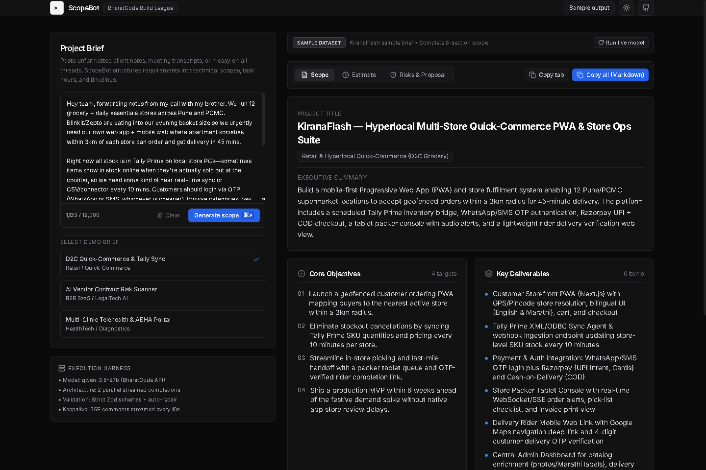
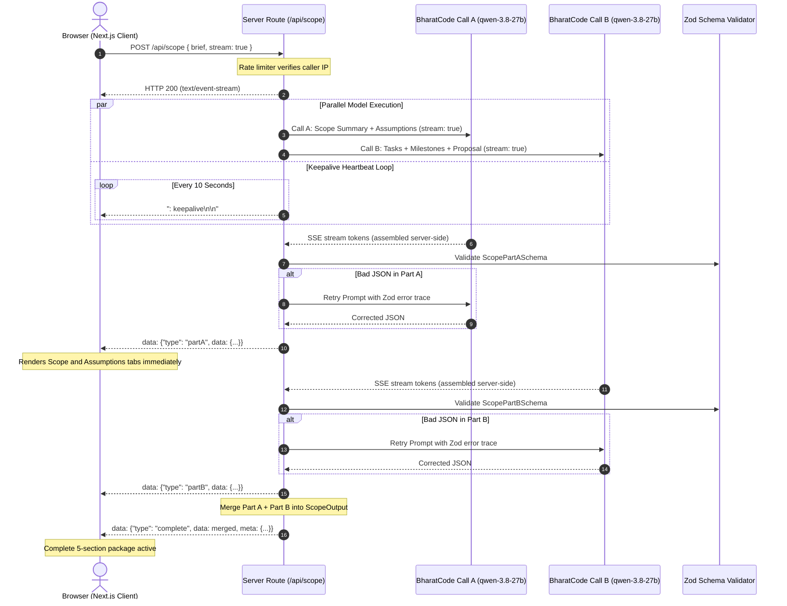

# ScopeBot

Convert unstructured client briefs and meeting transcripts into technical engineering specifications, task hour breakdowns, milestone schedules, and client proposal emails.

Live Demo: [https://scopebot-three.vercel.app](https://scopebot-three.vercel.app)

Built for the **BharatCode Build League**, powered by **qwen-3.8-27b** on the BharatCode Model API.

---

## Overview

Freelancers, software agencies, and technical leads spend substantial non-billable time parsing ambiguous, fragmented client inputs: voice note transcripts, unformatted Slack messages, and hurried email threads.

ScopeBot standardizes this intake process into a structured five-part technical package:

1. **Scope Summary**: Executive summary, business objectives, concrete deliverables, out-of-scope boundaries, and recommended tech stack.
2. **Assumptions Register**: Explicit technical assumptions categorized with impact ratings (Low, Medium, High).
3. **Clarifying Questions**: Prioritized discovery questions (Critical, Important, Nice-to-have) with rationale for initial client alignment.
4. **Task Breakdown & Hour Estimates**: Granular engineering work items with assigned roles, complexity weighting, min-max effort bounds, and calculated expected hours.
5. **Milestone Schedule & Proposal Email**: Phased delivery gates with deliverables and verifiable exit criteria, accompanied by a ready-to-send client proposal email.

---

## How It Works

```
[ 1. Input Brief ] ---> [ 2. Parallel Stream ] ---> [ 3. Zod Validate & Retry ] ---> [ 4. Tabbed Output ]
```

1. **Input Brief**: The user enters raw client notes (up to 12,000 characters) or selects one of three sample briefs (KiranaFlash, ArogyaSync, LedgerFlow).
2. **Parallel Streamed Inference**: `/api/scope` spawns two concurrent streaming requests to `qwen-3.8-27b` on BharatCode. Server-sent keepalive comments (`: keepalive\n\n`) are emitted every 10 seconds to keep HTTP connections alive while queued.
   - **Call A**: Scope summary, objectives, deliverables, out-of-scope boundaries, tech stack, assumptions, and client discovery questions.
   - **Call B**: Granular task breakdown, role allocation, complexity weights, hour estimates, milestone sequencing, and proposal email draft.
3. **Validation & Self-Repair**: The server strips reasoning traces (`<think>`), parses compact JSON, and validates payloads against strict Zod schemas. If malformed JSON or type mismatches occur, an automated retry prompt sends the exact error path back to the model for correction.
4. **Dev-Tool Output View**: Progressively renders Section 1 and 2 as soon as Call A resolves. When Call B completes, the interface displays the full tabbed output (`Scope`, `Estimate`, `Risks & Proposal`) with individual section copy controls, code/mono formatting, and complete Markdown export.

---

## Architecture



---

## Tech Stack

- **Framework**: Next.js 15 (App Router, Node.js runtime)
- **Language**: TypeScript 5.7 (Strict mode)
- **Styling**: Tailwind CSS 3.4 (Restrained dev-tool palette, 1px borders, 6px radius)
- **Typography**: Inter (`next/font/google`)
- **Validation**: Zod 3.24
- **Icons**: Lucide React
- **Inference Model**: `qwen-3.8-27b` via BharatCode Model API (`https://bharatcode.ai/api/model/v1`)
- **Hosting**: Vercel

---

## Local Setup

### Prerequisites

- Node.js v18.18 or higher (Node 20+ recommended)
- npm or pnpm
- BharatCode API Key

### 1. Clone the repository

```bash
git clone https://github.com/suryakant-source/scopebot.git
cd scopebot
```

### 2. Install dependencies

```bash
npm install
```

### 3. Configure environment variables

```bash
cp .env.example .env.local
```

Edit `.env.local`:

```ini
# BharatCode API credentials (server-only, never exposed to client)
BHARATCODE_API_KEY=your_bharatcode_api_key_here

# Model configuration
BHARATCODE_BASE_URL=https://bharatcode.ai/api/model/v1
BHARATCODE_MODEL=qwen-3.8-27b

# Rate limiting (per IP window)
RATE_LIMIT_MAX_REQUESTS=10
RATE_LIMIT_WINDOW_MS=60000
```

### 4. Run development server

```bash
npm run dev
```

Open [http://localhost:3000](http://localhost:3000) in your browser.

### 5. Typecheck and build

```bash
npm run typecheck
npm run build
```

---

## Environment Variables

| Variable | Required | Default | Description |
|---|---|---|---|
| `BHARATCODE_API_KEY` | Yes | None | BharatCode API authentication key. Kept strictly on the server. |
| `BHARATCODE_BASE_URL` | No | `https://bharatcode.ai/api/model/v1` | Base URL for OpenAI-compatible completions endpoint. |
| `BHARATCODE_MODEL` | No | `qwen-3.8-27b` | Target inference model ID. |
| `RATE_LIMIT_MAX_REQUESTS` | No | `10` | Maximum requests permitted per IP per window. |
| `RATE_LIMIT_WINDOW_MS` | No | `60000` | Sliding rate-limit window in milliseconds (default: 60s). |

---

## API Specification (`/api/scope`)

- **Method**: `POST`
- **Route Handler**: `src/app/api/scope/route.ts`
- **Runtime**: `nodejs` (`export const maxDuration = 300`)
- **Headers**:
  - `Content-Type: text/event-stream` (when `stream: true`)
  - `X-RateLimit-Limit`, `X-RateLimit-Remaining`, `X-RateLimit-Reset`

### Request Body

```json
{
  "brief": "Client wants an on-demand grocery delivery PWA with Tally Prime stock sync in Pune...",
  "stream": true
}
```

### SSE Stream Events (`stream: true`)

| Event | Payload | Description |
|---|---|---|
| `: keepalive` | Comment | Emitted every 10s to prevent proxy timeouts while upstream inference is queued. |
| `partA` | `{ scopeSummary, assumptionsAndQuestions }` | Emitted immediately once Call A is parsed and validated. |
| `partB` | `{ taskBreakdown, milestoneTimeline, proposalEmail }` | Emitted immediately once Call B is parsed and validated. |
| `complete` | `{ data: ScopeOutput, meta: { model, durationMs } }` | Merged final output ready for export. |
| `error` | `{ error: string, code: "TIMEOUT" \| "UPSTREAM_ERROR" }` | Emitted on failure with actionable error description. |

---

## Design Decisions

1. **Parallel 2-Call Splitting**: Generating all five sections sequentially in a single prompt required ~2,500 tokens, which exceeded the upstream latency threshold. Splitting into concurrent calls (Call A: Scope + Assumptions, Call B: Tasks + Milestones + Proposal) reduces wall-clock execution time by more than half.
2. **Server-Side Stream Assembly**: The server initiates upstream requests with `stream: true`, reading tokens incrementally to prevent proxy socket drops on long-running model generations.
3. **10-Second Keepalive Heartbeats**: During peak competition traffic when the model server queues requests, the API route continuously sends SSE comment pulses (`: keepalive\n\n`) to preserve client and edge connections up to the 240-second upstream timeout.
4. **Zod Validation & Auto-Repair Loop**: Outputs are validated against strict TypeScript/Zod schemas. If syntax errors or schema violations occur, the error path is sent directly back to the model in a targeted repair prompt.
5. **Pre-Generated Sample Output**: A complete pre-generated scope dataset (KiranaFlash) is embedded client-side, allowing judges and reviewers to explore the full interface immediately even if upstream API capacity is constrained.
6. **Restrained Dev-Tool Interface**: Built with a two-pane layout inspired by developer platforms (Linear, Stripe docs): 1px borders, 6px radius, neutral palette, monospace formatting for technical metrics, and zero marketing gimmicks.

---

## Limitations

- **Estimation Heuristics**: Hour estimates and phase distributions generated by `qwen-3.8-27b` serve as consultative engineering baselines. Technical teams should calibrate estimates against internal seniority and stack velocity prior to contractual execution.
- **Model Queue Latency**: Under peak competition volume, the BharatCode inference server may queue requests. ScopeBot handles this gracefully with live elapsed timers and SSE keepalives up to the 240-second cutoff.
- **In-Memory Rate Limiting**: The sliding-window rate limiter runs in server memory per container instance. Production multi-region deployments should back this with Redis or an edge KV store.

---

## Built for the BharatCode Build League

ScopeBot was architected and built for the **BharatCode Build League**.

- **Hosted Model**: `qwen-3.8-27b`
- **Model Endpoint**: `https://bharatcode.ai/api/model/v1`
- **Harness Documentation**: Detailed prompt engineering, schema definitions, and workflow design are documented in [`BharatCode.txt`](./BharatCode.txt).
- **Security**: `BHARATCODE_API_KEY` is accessed exclusively in server-side route handlers and is never transmitted to or bundled within client code.

---

## License

Distributed under the MIT License. Copyright (c) 2026 Suryakant Sahoo.
